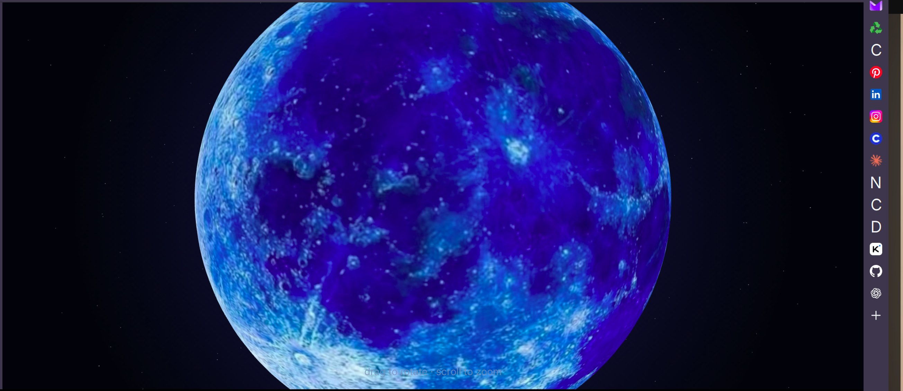
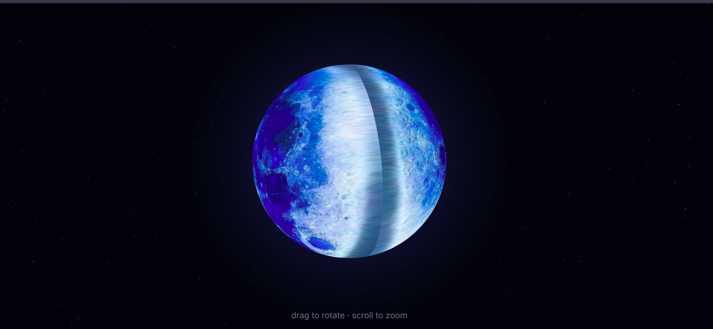
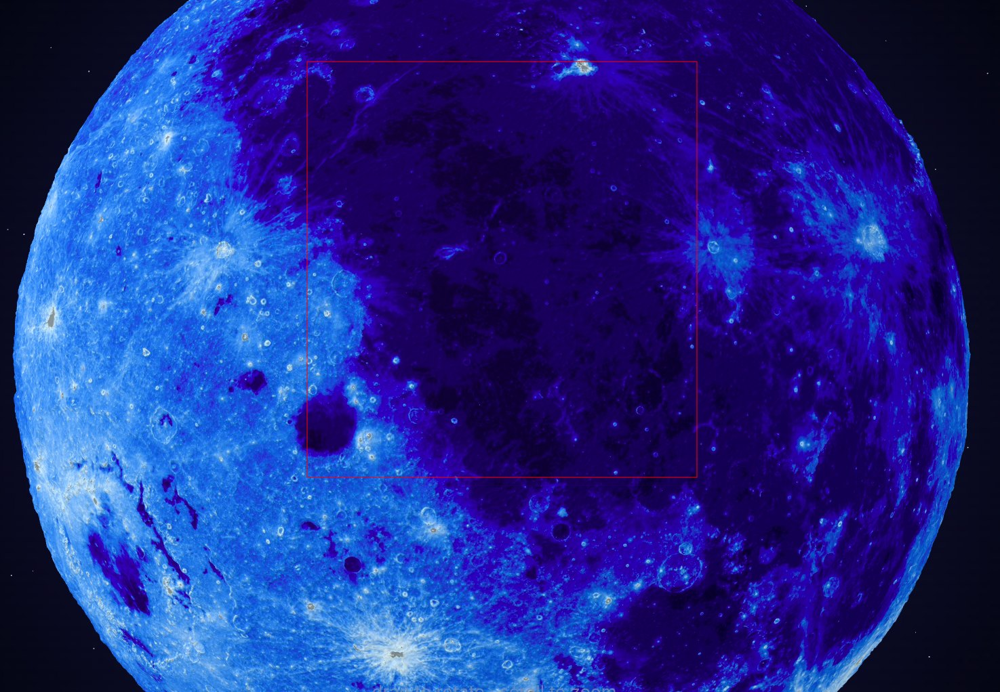
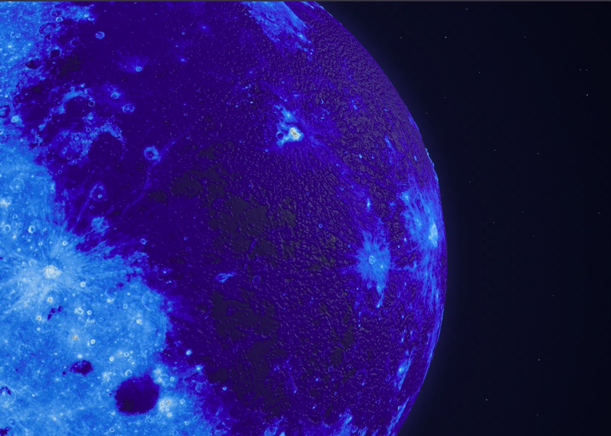
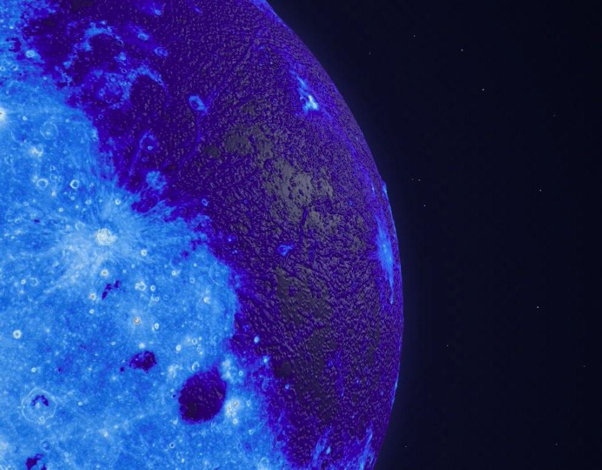

# Blue Moon — Interactive 3D Space Scene

A real-time 3D scene of a luminous blue Moon floating in a starfield. Drag to
rotate, scroll to zoom. Built with Three.js (WebGL), no build step — a single
HTML file plus textures.


*Art direction reference: `reference-blue-moon.jpg` — the scene's palette and
glow are matched to this image.*

## Process and authorship

This asset was **not hand-drawn or hand-modelled**. It was produced with a
data-driven pipeline under my art direction:

1. **Reference & direction** — I selected the reference image
   (`reference-blue-moon.jpg`) and directed the outcome through iterative
   review: palette and glow matching, relief depth (especially inside the
   dark maria), rotation behaviour, and consistency of the surface at every
   angle and zoom level.
2. **Source data** — real lunar photography (LROC, 8K) and laser altimetry
   (LOLA) from NASA's public CGI Moon Kit, re-graded into the reference
   palette by a custom Python/NumPy pipeline (`make_texture.py`) that
   samples the reference image's own luminance→color mapping and applies it
   to the real geography; elevation data drives displacement and normal
   maps, fused with photographic micro-relief.
3. **Rendering** — a hand-written Three.js scene (single `index.html`, no
   engine): displaced sphere, custom lighting balance (self-luminous moon,
   surface-locked accent light), sprite glow, procedural starfield.
4. **Tooling** — the pipeline and scene code were developed with an
   AI-assisted coding tool (Kimi Code CLI) executing my direction; every
   iteration was verified against rendered previews and the reference
   before acceptance.

What I controlled: concept, reference, art direction, acceptance criteria,
and iterative review. What is automated: image processing, map generation,
and boilerplate code.

### Process gallery

| | |
|---|---|
|  | **First working version** — the reference photo wrapped directly onto a sphere. Look matched the reference, but only one hemisphere of content existed. |
|  | **Identified issue: seam** — early attempts to extend a single photo around the sphere produced a visible junction stripe. Motivated rebuilding the texture pipeline on real full-sphere data (NASA LROC). |
|  | **Art direction pass** — marked region: the dark maria read as flat matte; relief (rilles, small craters) was then fused into the normal map specifically in dark regions, with a satin-sheen roughness map. |
|  | **Close-up inspection** — zoom checks drove the move from 2K to 8K textures and higher mesh tessellation. |
|  | **Close-up inspection** — surface grain and limb glow reviewed at high zoom. |

## Run it

Any static file server works. With Python:

```
python3 serve.py          # then open http://127.0.0.1:8642/
```

or simply `python3 -m http.server` in this folder.

## How it was made

- **Rendering** — Three.js: a displaced 512×512 sphere with color, normal,
  height and ambient-occlusion maps; fully matte (roughness 1.0 — real
  regolith has no gloss), mostly self-luminous material whose emissive map is
  pre-multiplied by AO so crater and maria cavities stay deep instead of
  glowing flat, with a subtle accent light locked to the moon so relief
  shading stays consistent while rotating; sprite-based limb glow and a
  procedural starfield.
- **Textures** — `make_texture.py` builds the maps from public NASA data
  (CGI Moon Kit, <https://svs.gsfc.nasa.gov/4720>):
  - `lroc_color_poles_8k.tif` (LROC orbital photography) re-graded into the
    blue palette of the reference image via a luminance→color LUT sampled
    from the reference itself;
  - `ldem_16.tif` (LOLA laser altimetry) for real displacement, fused with
    photographic micro-relief (rilles, small craters) in the normal map,
    weighted into the dark maria;
  - an ambient-occlusion map derived from elevation deepens cavities, and
    also modulates the emissive map so the self-glow is occluded like real
    light.

The raw NASA source files are not included (size); download them from the
link above into this folder to regenerate the maps with `make_texture.py`.

## Files

| File | Purpose |
|---|---|
| `index.html` | The whole scene (ES modules, Three.js from CDN) |
| `moon_eq.jpg` | 8K equirectangular color map, blue-graded |
| `moon_normal.png` | Tangent-space normal map (elevation + photo micro-relief) |
| `moon_height.png` | Displacement map (real LOLA elevation) |
| `moon_ao.png` | Ambient occlusion from elevation (deepens cavities) |
| `moon_emis.jpg` | Emissive map — color × AO, so self-glow is occluded in cavities |
| `reference-blue-moon.jpg` | Art direction reference image |
| `make_texture.py` | Texture generation pipeline |
| `serve.py` | Local dev server with caching disabled |
