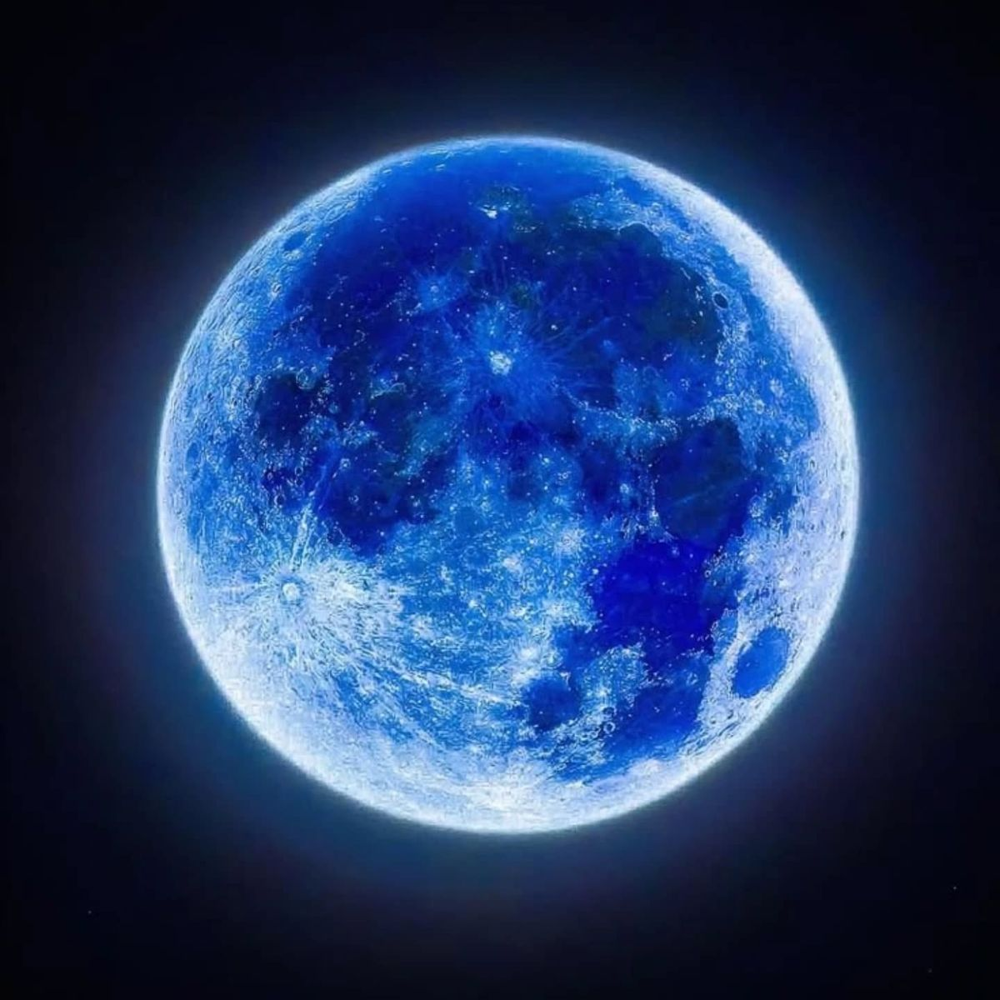

# Blue Moon — Interactive 3D Space Scene

A real-time 3D scene of a luminous blue Moon floating in a starfield. Drag to
rotate, scroll to zoom. Built with Three.js (WebGL), no build step — a single
HTML file plus textures.



*Art direction reference: `reference-blue-moon.jpg` — the scene's palette and
glow are matched to this image.*

## Run it

Any static file server works. With Python:

```
python3 serve.py          # then open http://127.0.0.1:8642/
```

or simply `python3 -m http.server` in this folder.

## How it was made

- **Rendering** — Three.js: a displaced 512×512 sphere with color, normal,
  height and roughness maps; mostly self-luminous material with a subtle
  accent light locked to the moon so relief shading stays consistent while
  rotating; sprite-based limb glow and a procedural starfield.
- **Textures** — `make_texture.py` builds the maps from public NASA data
  (CGI Moon Kit, <https://svs.gsfc.nasa.gov/4720>):
  - `lroc_color_poles_8k.tif` (LROC orbital photography) re-graded into the
    blue palette of the reference image via a luminance→color LUT sampled
    from the reference itself;
  - `ldem_16.tif` (LOLA laser altimetry) for real displacement, fused with
    photographic micro-relief (rilles, small craters) in the normal map,
    weighted into the dark maria;
  - a roughness map gives the dark maria a satin sheen so their relief
    responds to the accent light.

The raw NASA source files are not included (size); download them from the
link above into this folder to regenerate the maps with `make_texture.py`.

## Files

| File | Purpose |
|---|---|
| `index.html` | The whole scene (ES modules, Three.js from CDN) |
| `moon_eq.jpg` | 8K equirectangular color map, blue-graded |
| `moon_normal.png` | Tangent-space normal map (elevation + photo micro-relief) |
| `moon_height.png` | Displacement map (real LOLA elevation) |
| `moon_rough.png` | Roughness map (dark maria = satin sheen) |
| `reference-blue-moon.jpg` | Art direction reference image |
| `make_texture.py` | Texture generation pipeline |
| `serve.py` | Local dev server with caching disabled |
