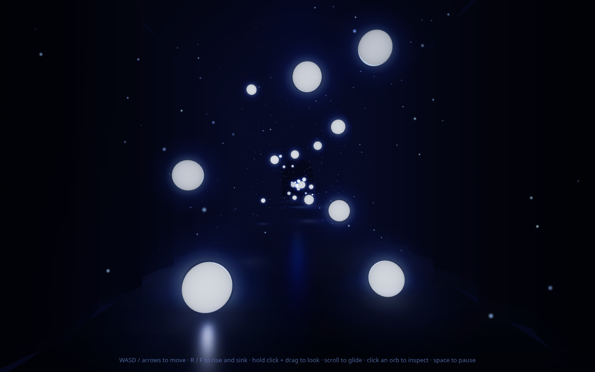
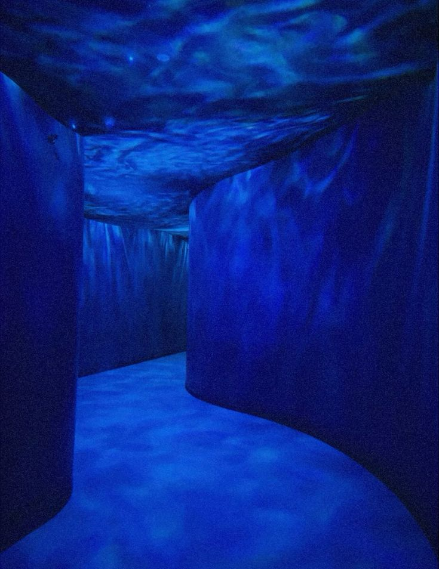
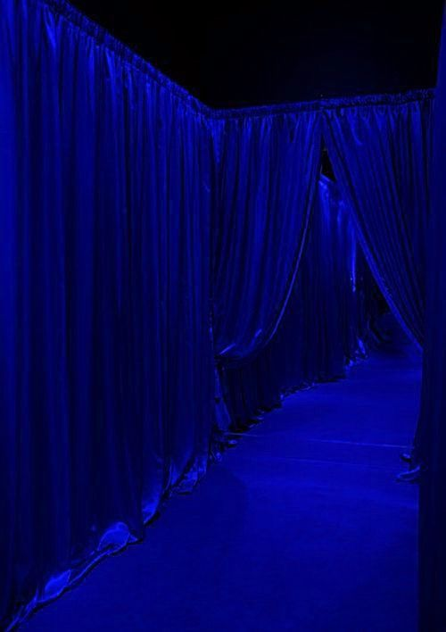
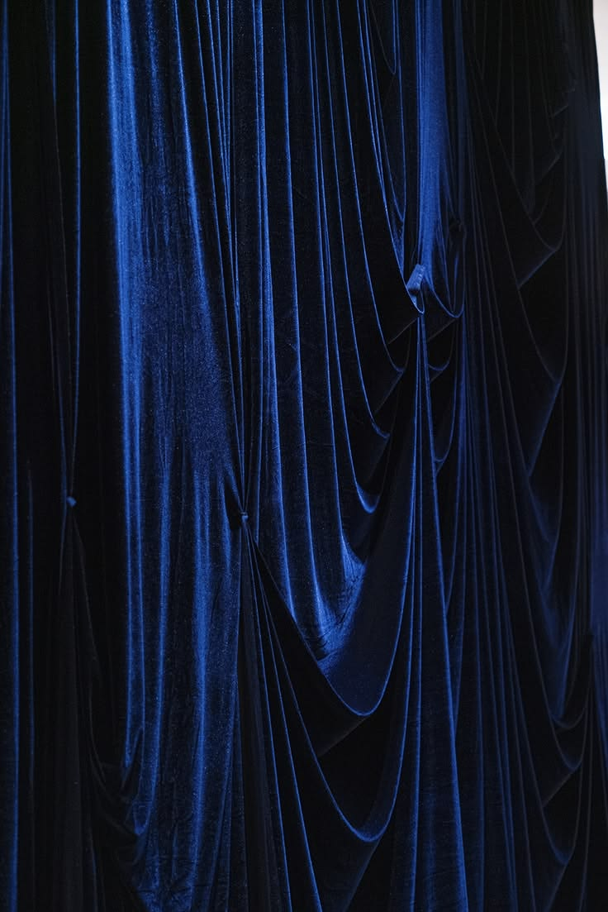
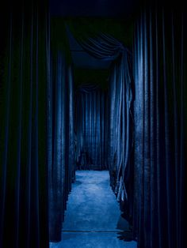
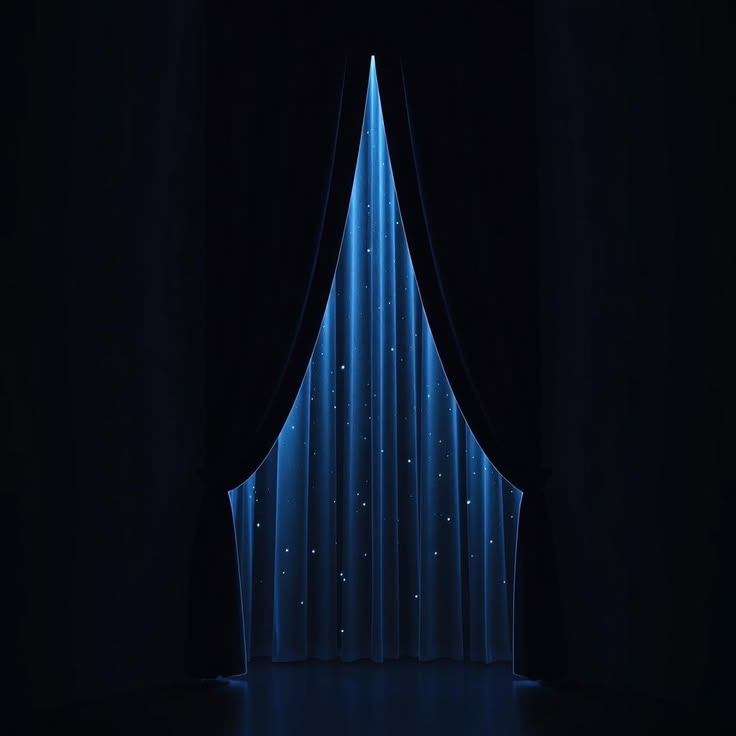

# Luminous Corridor — Interactive Crowd Installation

A real-time 3D installation: a vaulted, drape-lined corridor inhabited by a
crowd of luminous orbs, each with its own behaviour. You float among them —
they notice you. Built with Three.js (WebGL), no build step — a single HTML
file.



## Process and authorship

This scene was produced under my art direction with an AI-assisted coding
tool (Kimi Code CLI) executing the implementation:

1. **Concept & direction** — I defined the piece: a "controlled environment"
   feel — a hall separated from outer space by heavy velvet drapes — and
   directed the outcome through iterative review: crowd behaviour (rushing,
   ascending, travelling in pairs, curiosity toward the visitor), spatial
   distribution (walls, ceiling, depth — never a central cluster), pacing,
   and the drape material.
2. **Reference & review** — drape look and mood were directed from collected
   reference photography of velvet stage curtains and blue-lit fabric
   installations (see the gallery below); every iteration was verified
   against rendered previews before acceptance, and rejected directions were
   reverted.
3. **Implementation** — a hand-written Three.js scene (single `index.html`,
   no engine): custom shaders for the orb glow and halos, a behaviour system
   for the crowd, procedural velvet texture, physically based materials.

### Art direction references

| | |
|---|---|
|  | **`reference-blue-corridor.jpg`** — the core mood: a corridor walled off from the outside by fabric, everything bathed in blue. |
|  | **`reference-velvet-installation.jpg`** — heavy velvet as architecture: gathered headers, deep fold shadow, slight pooling at the hem. |
|  | **`reference-velvet-closeup.jpg`** — the material target: nap sheen on fold crests, near-black valleys. |
|  | **`reference-dark-hall.jpg`** — how dark the drapes may go while still reading as cloth. |
|  | **`reference-light-curtain.jpg`** — reference for the orbs' glow behaviour against dark fabric. |

What I controlled: concept, references, art direction, acceptance criteria,
and iterative review. What is automated: shader and behaviour code,
procedural texture generation.

## Run it

Any static file server works. With Python:

```
python3 serve.py          # then open http://127.0.0.1:8642/
```

or simply `python3 -m http.server` in this folder.

**Controls** — WASD / arrows to move, R / F to rise and sink, hold click +
drag to look, scroll to glide, click an orb to inspect it, space to pause.

## How it was made

- **Crowd behaviour** — each orb has a role and its own agenda: *rushers*
  hurry the length of the hall (and sometimes change their mind mid-flight),
  *ascenders* press up against the vault and keep their own roost under the
  ceiling (occasionally losing heart and sinking before climbing again),
  *companions* travel in pairs and trios holding a loose formation,
  *curious* orbs notice the visitor, drift over to a polite distance at eye
  level, then get bored and wander off. Wanderers roam personal home cells —
  a stratified 4-lane × 6-segment layout guarantees the spread — and
  sometimes visit other altitudes. Orbs keep personal space, swirl around
  the visitor like electrons, and excitement ripples between neighbours.
- **Orbs** — unlit energy spheres with a custom fresnel shader (the
  silhouette melts into an additive halo), a floor reflection "pool" that
  stretches toward the viewer, breathing, blinking, glitch bursts, and glow
  personalities (shy orbs dim under attention, curious ones flare).
- **Environment** — barrel-vault ceiling, procedurally waved drapes with a
  generated seamless velvet-nap texture (mottled bloom/pit stamping plus
  fine grain, applied as color and bump maps), and 900 drifting dust motes
  that shy away as you pass.
- **Camera** — a free-fly POV with mass (velocity eases, never snaps), an
  inspect mode that glides to a clicked orb and back, and soft collision so
  you can never pass through an orb.

## Files

| File | Purpose |
|---|---|
| `index.html` | The whole scene (ES modules, Three.js from CDN) |
| `screenshot.png` | In-scene capture |
| `reference-*.jpg` | Art direction reference images (drapes, velvet, mood) |
| `serve.py` | Local dev server with caching disabled |
